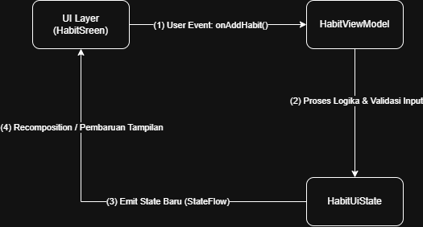
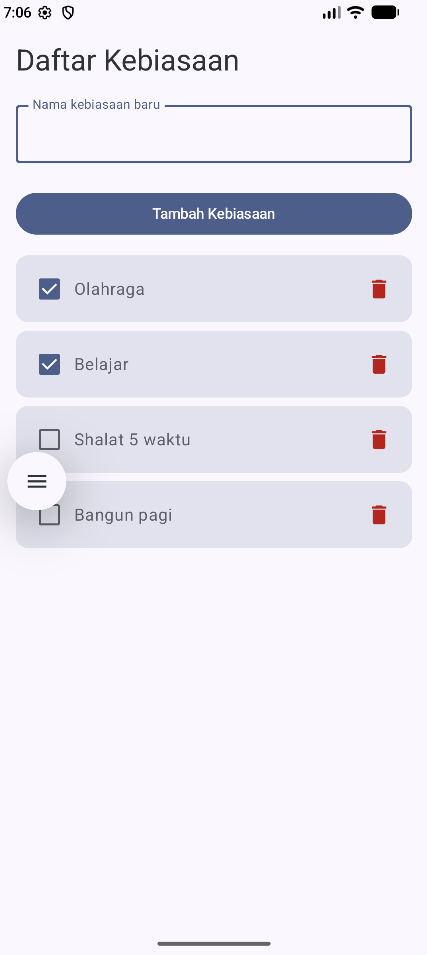
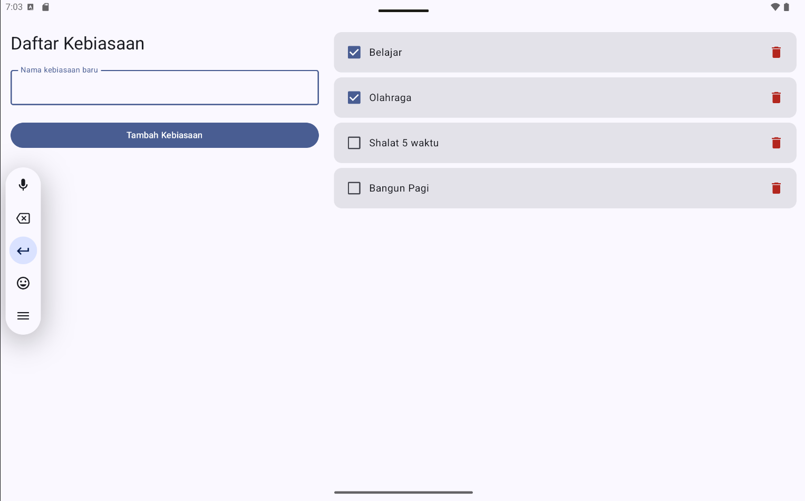

# HabitKu - Aplikasi Pencatat Kebiasaan Baik 

Aplikasi Android sederhana berbasis **Jetpack Compose** dengan arsitektur **MVVM (Model-View-ViewModel)**, **UI State**, **StateFlow**, dan **Unidirectional Data Flow (UDF)**. Dilengkapi dengan antarmuka adaptif (**Adaptive Layout**) untuk layar sempit dan lebar.

---

## Anggota Kelompok & Kontribusi

| Nama | NIM | Kontribusi UI/UX & Fitur Aplikasi                                                                                                                                                                                                                                                                                                                                                                   |
| :--- | :--- |:----------------------------------------------------------------------------------------------------------------------------------------------------------------------------------------------------------------------------------------------------------------------------------------------------------------------------------------------------------------------------------------------------|
| **[Nama Anggota 1]** | [NIM Anggota 1] | Membuat struktur layar utama (`HabitScreen` & `Scaffold`) dan mengimplementasikan *Adaptive Layout* menggunakan `BoxWithConstraints` (tampilan bertumpuk untuk HP, 2-panel untuk Tablet).<br>**Fitur & Logika:** Membangun fondasi arsitektur data (`HabitUiState`, `Habit`), inisialisasi *StateFlow* pada ViewModel, dan menghubungkan UI dengan state menggunakan `collectAsStateWithLifecycle`. |
| **[Nama Anggota 2]** | [NIM Anggota 2] | Merancang komponen formulir input (`InputForm`), mengatur tata letak `OutlinedTextField`, tombol tambah, dan pesan error warna merah saat validasi gagal.<br>**Fitur & Logika:** Mengembangkan logika fitur **Tambah Kebiasaan**, termasuk pengelolaan *draft* teks saat mengetik, validasi anti-kosong/spasi, pembuatan ID unik (UUID), dan fungsi simpan ke memori.                               |
| **[Nama Anggota 3]** | [NIM Anggota 3] | Membuat komponen daftar (`HabitListContent`), menyusun *LazyColumn* dan *Card* (berisi *Checkbox*, teks nama, ikon hapus), serta membuat UI *Empty State* ("Belum ada kebiasaan").<br>**Fitur & Logika:** Mengembangkan logika manipulasi daftar kebiasaan, yaitu fitur **Ubah Status Selesai** (mencentang kebiasaan) dan fitur **Hapus Kebiasaan** dari dalam *ViewModel*.                        |

---

## Masalah, Pengguna, dan Solusi

* **Pengguna Sasaran:** Siapa saja (pelajar, mahasiswa, pekerja) yang ingin membangun dan melacak rutinitas positif harian.
* **Masalah:** Banyak orang kesulitan menjaga konsistensi kebiasaan baik (seperti minum air, membaca buku, olahraga) karena tidak memiliki catatan harian yang praktis. Aplikasi pencatat kebiasaan di pasaran sering kali terlalu kompleks, penuh iklan, atau tampilannya rusak saat dibuka di tablet.
* **Solusi:** Aplikasi *HabitKu* yang fokus pada satu layar utama dengan 3 fitur inti tanpa memerlukan login atau koneksi internet. Antarmuka bersih, responsif, dan langsung beradaptasi dengan nyaman di layar *smartphone* maupun tablet.

---

## Fitur Utama

1. **Tambah Kebiasaan & Validasi Input:** Menambahkan rutinitas baru ke dalam daftar. Jika input kosong, sistem menampilkan pesan error *"Nama kebiasaan tidak boleh kosong"*.
2. **Ubah Status Selesai (Toggle Completion):** Menandai kebiasaan yang sudah dilakukan hari ini menggunakan *checkbox*.
3. **Hapus Kebiasaan (Delete Habit):** Menghapus rutinitas dari daftar lokal menggunakan tombol ikon tempat sampah.
4. **Adaptive & Responsive Layout:**
    * **Layar Sempit (<600dp / HP Potret):** Tampilan bertumpuk secara vertikal.
    * **Layar Lebar (≥600dp / Tablet / HP Lanskap):** Tampilan terbagi menjadi 2 panel berdampingan (Formulir di kiri, Daftar di kanan).
5. **Handling State Data Kosong:** Menampilkan pesan motivasi khusus *"Belum ada kebiasaan. Tambahkan kebiasaan baik pertama Anda!"* saat daftar masih kosong.

---

## Alur Unidirectional Data Flow (UDF)

Aplikasi ini menerapkan alur data satu arah (UDF) secara ketat pada setiap interaksi pengguna:

```text
[ UI Layer (HabitScreen) ]  --- (1) User Event: onAddHabit() ---> [ HabitViewModel ]
▲                                                                     │
│                                                            (2) Proses Logika &
│                                                                Validasi Input
│                                                                     │
(4) Recomposition /                                                   ▼
Pembaruan Tampilan    <--- (3) Emit State Baru (StateFlow) --- [ HabitUiState ]
```

<p align="center">
  
</p>

### Penjelasan Langkah Alur UDF (Contoh: Menambah Kebiasaan):
1. **User Event (UI ke ViewModel):** Pengguna mengetik *"Minum 2L Air"* lalu mengeklik *"Tambah Kebiasaan"*. UI memicu *callback* `onAddHabit()` menuju `HabitViewModel`.
2. **Proses Logika (ViewModel):** `HabitViewModel` memvalidasi input teks dari spasi kosong.
3. **Pembaruan State (ViewModel ke UI State):** ViewModel membuat objek `Habit` baru dan memperbarui `_uiState` (`MutableStateFlow`) menggunakan `copy()`. `uiState` (*read-only*) memancarkan `HabitUiState` terbaru.
4. **Pembaruan UI (State ke UI):** `HabitRoute` menerima snapshot state terbaru via `collectAsStateWithLifecycle()`. Compose melakukan *recomposition*, kebiasaan baru muncul di daftar, dan kolom isian kembali kosong.

---

## Tangkapan Layar (Screenshots)

| Layar Sempit (Compact Layout / HP Potret) | Layar Lebar (Expanded Layout / Tablet / Lanskap) |
| :---: | :---: |
|  |  |

---
